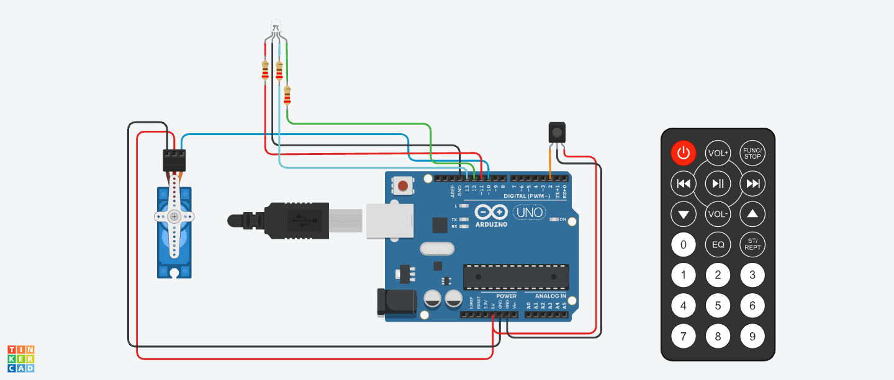

# Electronic Door Lock with RGB Indicator (Tinkercad)

This project is a password-controlled electronic door lock simulated in Tinkercad. An Arduino Uno reads a PIN entered through a 4x4 keypad. A micro servo represents the physical locking mechanism.

An RGB LED provides all status feedback. Seven different colours tell the user whether the door is locked, whether access was granted or denied, and which step of the PIN-change process is in progress. The project demonstrates the basic operating principle behind keypad-controlled access systems used in doors, lockers, cabinets, and other security systems.

**Version 2** adds a user-changeable PIN. The owner can set a new PIN from the keypad without editing the program. The default PIN is still `1234`.

🔗 **Tinkercad simulation:** [open the circuit](https://www.tinkercad.com/things/i7V48scyurK-electronic-door-with-rgb-light-indicator-version3)

---

## What changed in version 2

| Area | Version 1 | Version 2 |
| ---- | --------- | --------- |
| PIN | Fixed at `1234` in the program | Default `1234`, changeable from the keypad |
| RGB indicator | Three colours | Seven colours |
| Keypad letters | `A` `B` `C` `D` unused | `A` starts a PIN change, `B` cancels |
| Program structure | One fixed behaviour | A state machine with six states |
| Timing | `delay()` blocked the whole program | Non-blocking timing using `millis()` |
| 16x2 I2C LCD | Attempted, failed, removed | Attempted again, failed again, still removed |

Version 1 remains available as a release so the original project can still be viewed and simulated.

---

## How it works

The Arduino continuously scans the 4x4 keypad for key presses. Number keys are added to the entry. The `*` key clears the current entry, `#` submits it, `A` begins a PIN change, and `B` cancels and returns to the locked state.

The PIN starts as `1234` every time the simulation starts.

When the entered PIN is correct, the RGB LED turns green and the servo rotates from 0° to 90°. This represents the door unlocking. After 5 seconds, the servo returns to 0° and the LED returns to blue. If the PIN is incorrect, the LED turns red for 2 seconds and the servo does not move.

### Changing the PIN

Pressing `A` from the locked state begins a three-step process. Each step has its own colour, which is how the user knows which question is being asked.

| Step | Colour | The system is asking for |
| ---- | ------ | ------------------------ |
| 1 | Magenta | The current PIN |
| 2 | Cyan | A new PIN, 4 to 8 digits |
| 3 | Yellow | The new PIN a second time |

If all three steps succeed, the LED turns white and the new PIN takes effect immediately. The new PIN is required to confirm, so a typo cannot silently lock the owner out. If the current PIN is wrong, the request is refused. If the two new entries do not match, the process returns to step 2. Pressing `B` at any point cancels, and the process gives up on its own after 15 seconds of inactivity.

A changed PIN is held in RAM, so it lasts until the simulation is stopped. Storing it permanently requires the EEPROM and is planned for version 3.

### Colour reference

| Colour | Channels on | Meaning |
| ------ | ----------- | ------- |
| Blue | B | Door locked, waiting for a PIN |
| Green | G | Access granted, door open |
| Red | R | Refused, or an entry was rejected |
| Magenta | R + B | Change PIN, step 1 |
| Cyan | G + B | Change PIN, step 2 |
| Yellow | R + G | Change PIN, step 3 |
| White | R + G + B | The PIN was changed |

The keypad is a matrix keypad. Its 16 buttons are arranged as four rows and four columns. This allows the Arduino to identify 16 different buttons using only eight input/output pins.

The RGB LED is a common-cathode type. Its common cathode is connected to ground, so each channel lights when its Arduino pin is driven HIGH. Pins D12 and D13 are not PWM pins, so each channel is either fully on or fully off. That gives exactly seven colours: the three channels alone, the three pairs, and all three together. Version 2 uses all seven.

---

## Design files

| File | Description |
| ---- | ----------- |
| [Schematic (PDF)](Electronic_Door_Lock.pdf) | Schematic view of the completed circuit |
| [PCB board file (.brd)](Electronic_Door_Lock.brd) | Board design file associated with the project |
| [`electronic_door_lock.ino`](electronic_door_lock.ino) | Arduino C++ program for the door lock |

The circuit is unchanged from version 1, so the schematic, board file, and photograph still apply.

---

## Parts

| Part (Tinkercad name) | Qty | Settings |
| --------------------- | --- | -------- |
| Arduino Uno R3 | 1 | 5 V logic |
| Keypad 4x4 | 1 | 4 rows, 4 columns |
| Micro Servo | 1 | 0° locked, 90° unlocked |
| RGB LED | 1 | Common cathode |
| Resistor | 3 | 220 Ω, one for each RGB channel |
| Connecting wires | As required | Used for signal, 5 V and GND connections |

For real hardware, an Arduino Uno or another 5 V compatible microcontroller could be used. A small hobby servo such as an SG90 can demonstrate the locking motion. A real door lock would normally use a suitable solenoid, geared motor, or dedicated electronic locking mechanism with a proper driver circuit and separate power supply.

Each RGB LED channel should have its own current-limiting resistor. A value around 220 Ω is suitable for this demonstration.

---

## Wiring

### 4x4 keypad

| Keypad pin | Arduino pin | Purpose |
| ---------- | ----------- | ------- |
| Row 1 | D2 | Keypad row |
| Row 2 | D3 | Keypad row |
| Row 3 | D4 | Keypad row |
| Row 4 | D5 | Keypad row |
| Column 1 | D6 | Keypad column |
| Column 2 | D7 | Keypad column |
| Column 3 | D8 | Keypad column |
| Column 4 | D9 | Keypad column |

### Micro servo

| Servo connection | Arduino connection |
| ---------------- | ------------------ |
| Signal | D10 |
| Power | 5V |
| Ground | GND |

### Common-cathode RGB LED

| RGB LED connection | Arduino connection |
| ------------------ | ------------------ |
| Red | D11 through 220 Ω resistor |
| Green | D12 through 220 Ω resistor |
| Blue | D13 through 220 Ω resistor |
| Common cathode | GND |

⚠️ Do not connect the RGB LED channels directly to the Arduino outputs without current-limiting resistors.

⚠️ The common pin of the RGB LED used in this project is the cathode and must be connected to GND. A common-anode RGB LED requires different wiring and inverted control logic.

⚠️ A real high-current door lock or large servo should not be powered directly from an Arduino output pin. A suitable driver and power supply should be used.

---

## Keypad reference

| Key | Action |
| --- | ------ |
| `0` to `9` | Enter a digit |
| `#` | Submit the entry |
| `*` | Clear the digits typed so far |
| `A` | Start changing the PIN |
| `B` | Cancel and return to the locked state |
| `C`, `D` | Not used in this version |

---

## Test procedure

1. Start the simulation. The RGB LED should turn blue and the servo should remain at 0°.

2. Enter `1234` and press `#`. The LED should turn green and the servo should rotate to 90°.

3. Wait 5 seconds. The servo should return to 0° and the LED should return to blue.

4. Enter an incorrect PIN such as `1111` and press `#`. The LED should turn red for 2 seconds, the servo should not move, and the LED should then return to blue.

5. Begin entering a PIN and press `*`. The entry should be cleared.

6. Press `A`. The LED should turn magenta.

7. Enter `1234` and press `#`. The LED should turn cyan.

8. Enter `9999` and press `#`. The LED should turn yellow.

9. Enter `9999` and press `#`. The LED should turn white, then return to blue.

10. Enter `9999` and press `#`. Access should be granted.

11. Enter `1234` and press `#`. Access should be denied, because the old PIN no longer works.

12. Press `A`, then press `B`. The system should return to the locked state with the PIN unchanged.

13. Press `A`, then wait 15 seconds without pressing anything. The process should give up on its own.

14. Press `A`, enter the current PIN, then enter a 3-digit new PIN and press `#`. It should be rejected as too short.

15. Press `A`, enter the current PIN, then enter two different new PINs. The second entry should be rejected and the process should return to step 2.

16. Stop and restart the simulation. The PIN should be `1234` again.

17. Open the Serial Monitor throughout. Each state change and access result should be printed, and entered digits should appear only as `*`.

---

## Results and observations

- The 4x4 keypad successfully provided PIN input to the Arduino.

- The default PIN `1234` was correctly recognised.

- A new PIN set through the keypad took effect immediately and the previous PIN stopped working.

- All seven RGB colours were distinguishable in the Tinkercad simulation.

- The micro servo rotated from 0° to 90° when access was granted and returned to 0° afterwards.

- Replacing `delay()` with `millis()` allowed the three-step PIN change to work. The earlier version could not have supported it, because the program was frozen for seconds at a time.

- A changed PIN did not survive stopping and restarting the simulation, which is expected, since it is only held in RAM.

- The servo movement used by the program is:

    $\Delta\theta = 90^\circ - 0^\circ = 90^\circ$

- The programmed unlocked time is:

    $t_{unlock} = 5000\text{ ms} = 5\text{ s}$

- The programmed result-colour time is:

    $t_{result} = 2000\text{ ms} = 2\text{ s}$

- The PIN-change inactivity timeout is:

    $t_{timeout} = 15000\text{ ms} = 15\text{ s}$

- No electrical voltage or current measurements were recorded for the completed circuit.

---

## Known issues and limitations

### The I2C LCD still does not work

A 16x2 I2C LCD was planned for both version 1 and version 2, to display messages such as `Access Granted` and `Access Denied` and to show which step of the PIN change is in progress.

In version 2 the following was established and still did not produce a working display:

- The LCD was wired with SDA to A4, SCL to A5, VCC to 5 V, and GND to GND, which is correct for an Arduino Uno.
- The I2C address was confirmed as `0x20`. Most online examples use `0x27` or `0x3F`, which are the addresses of physical PCF8574 backpacks and are wrong for this component. This was a genuine fault in the version 1 attempt.
- With the address corrected, Tinkercad reported `invalid header file` when the LCD library was included, and the sketch would not compile.
- Both `Adafruit_LiquidCrystal` and `LiquidCrystal_I2C` were tried.

Because the lock itself works without it, the LCD was dropped from version 2 rather than delaying the release. The RGB LED carries all feedback instead. This is a workaround, not a solution, and the LCD remains an open problem.

### Other limitations

- A changed PIN is lost when the simulation stops. There is no permanent storage.
- The RGB LED communicates the system state but cannot display messages or show how many digits have been entered.
- There is no lockout after repeated incorrect attempts.
- The PIN is held in plain text in RAM. A real access-control system would store a hash rather than the PIN itself.
- Yellow and white rely on the three dice inside the RGB LED being evenly matched. On real low-cost parts they usually are not, so these two colours would look less accurate on physical hardware than they do in simulation.
- Since D12 and D13 are not PWM pins, only seven fully-on colour combinations are available. Dimming and intermediate colours are not possible with the current wiring.
- The micro servo represents a door lock. The simulation does not test the mechanical forces required to operate a real door lock.
- The circuit has not been verified as a physical door security system.
- No electrical current or voltage measurements were recorded for the final design.

---

## Things I learned

- A microcontroller can read a matrix keypad by scanning its rows and columns, giving 16 buttons from eight pins.
- A program that has to ask more than one question needs to remember which question it is asking. This is a state machine, and it replaced the single fixed behaviour of version 1.
- `delay()` stops everything, including reading the keypad. Timing with `millis()` instead lets the program keep responding while it waits, which is what made the PIN-change feature possible.
- Asking the user to confirm a new PIN prevents a typo from permanently locking them out.
- A common-cathode RGB LED driven by three digital pins produces exactly seven colours, and those colours can carry an entire user interface when no display is available.

---

## Future improvements

- Resolve the `invalid header file` error and finally get the 16x2 I2C LCD working.
- Display masked characters such as `****` while the PIN is being entered.
- Display `Access Granted`, `Access Denied`, and the PIN-change prompts on the LCD.
- Add a maximum number of incorrect attempts followed by a temporary lockout.
- Store a hash of the PIN rather than the PIN itself.
- Add a buzzer for audible feedback.
- Add a door-position sensor to detect whether the door is actually open or closed.
- Build a physical prototype and measure its supply voltage and current consumption.
- Replace the demonstration servo with a suitable locking actuator and driver circuit for a real prototype.

---

## Version history

| Version | Summary |
| ------- | ------- |
| v1 | Fixed PIN `1234`, three RGB colours, LCD attempted and removed |
| v2 | User-changeable PIN, seven RGB colours, state machine, non-blocking timing |

---

## License

MIT
